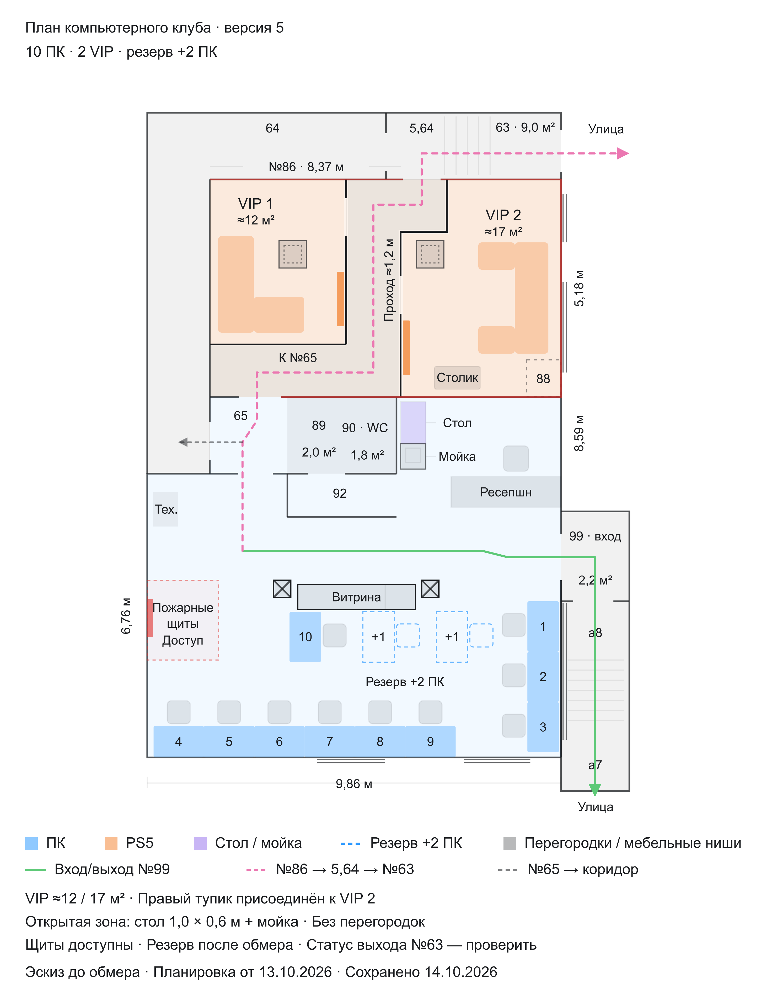

# Бизнес-план игрового клуба

Рабочие материалы проекта игрового клуба в Хабаровске: концепция, исходные данные и планировка.

## Материалы

- [Концепция клуба](Концепция-клуба.md) — идеи, направления деятельности и вопросы для дальнейшей проработки.
- [Контекст планировки](Планировка-клуба.md) — исходные данные и принятые решения.
- [Планировка, версия 5](Планировка/README.md) — описание файлов и краткий контекст.
- [Интерактивный план](Планировка/План-клуба-v5.html) — скачайте и откройте в браузере.

## План клуба

Размеры и площади ориентировочные. Материалы отражают рабочую концепцию; расчёты и нормативные требования требуют дальнейшей проверки.
