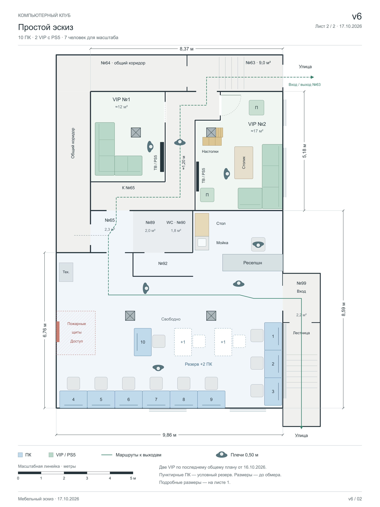

# Бизнес-план игрового клуба в Хабаровске

Актуализация: **4 ноября 2026 года**. Рабочая концепция: **10 игровых ПК, отдельный ПК администратора и две VIP-зоны с PS5** в помещении около 120 м². Основная планировка — **v6 от 17.10.2026**. Закупки, договоры и полный бюджет открытия ещё не подтверждены.

## Основные документы

| Документ | Содержание |
|---|---|
| [Концепция бизнеса](Концепция-клуба.md) | Формат клуба, услуги на запуске, дополнительные идеи и открытые вопросы |
| [Общая планировка](Планировка-клуба.md) | Помещения, 10 ПК, ресепшн, проходы, размеры и ограничения v6 |
| [Планировка VIP-зон](Планировка-VIP.md) | Текущая расстановка обеих VIP и статус альтернатив VIP №1 |
| [Общий документ затрат](Затраты-клуба.md) | Вложения на запуск, ПО, интернет, электричество, персонал и прочие расходы |
| [Компьютерное место](Компьютерное-место.md) | Комплектующие, мебель, периферия, источники и стоимость одного и десяти мест |
| [Изображения, планы и оригиналы](Материалы/README.md) | Актуальные PNG/SVG/HTML, редактируемые исходники и отдельно обозначенный архив |

Технические приложения: [ПО и LANGAME](Расходы-на-ПО.md), [интернет и локальная сеть](Интернет-и-сеть-клуба.md).

## Текущие ориентиры бюджета

| Показатель | Сумма | Статус |
|---|---:|---|
| Одно компьютерное место | 219 358 ₽ | Сохранённые цены 23.10–04.11.2026; текущая стоимость требует обновления |
| Десять компьютерных мест | 2 193 580 ₽ | Без ПК администратора, доставки, сборки и ПО |
| Сеть и подключения | 150 000 ₽ | Предварительная оценка; предложений подрядчиков нет |
| **Учтённая часть вложений** | **2 343 580 ₽** | **Полный бюджет запуска ещё не рассчитан** |
| LANGAME + связь + электричество | 60 000 ₽/мес. | Сценарий 20 000 + 20 000 + 20 000 ₽; полный операционный бюджет будет выше |

Статусы сумм, расчёт электричества и все неоценённые статьи — в [общей смете](Затраты-клуба.md). Неизвестные расходы не равны нулю. Для LANGAME пока посчитаны 11 устройств; подключение двух ТВ VIP может увеличить оплату.

## Актуальные планы

- [Общий эскиз PNG](Материалы/Планы/Общий-план-v6/План-клуба-v6-эскиз.png).
- [Подробный план с размерами PNG](Материалы/Планы/Общий-план-v6/План-клуба-v6-с-размерами.png).
- [Два листа в HTML](Материалы/Планы/Общий-план-v6/План-клуба-v6.html) — скачать вместе с каталогом и открыть в браузере; GitHub показывает исходный код.
- [VIP №1 и №2 с коридорами PNG](Материалы/Планы/VIP-1-и-VIP-2/План-VIP-1-и-VIP-2-с-коридорами.png).

## Следующие решения

Основа проекта: две VIP, десять игровых мест, свободное пространство между нижними колоннами, ресепшн у входа №99, открытые стол и мойка у WC. VIP №2 — выбранный «Стеллаж у колонны». VIP №1 сохраняет угловой диван из общего плана; три альтернативы не выбраны. Резерв на два ПК условный.

До закупки и окончательного бюджета нужны обмер, проверка проходов и инженерных систем, условия пользования помещением, предложения поставщиков и провайдеров, фактическая цена электричества, график работы и штат. Столы в смете глубиной 80 см, на плане — 75 см: расстановку нужно согласовать с мебелью. Детские занятия остаются отдельной идеей до проверки пригодности объекта.

## Структура и обновление

Основные тексты находятся в корне. В `Материалы/Планы/` — действующие планы с исходниками, в `Материалы/Оригиналы/` — исходный план помещения, в `Материалы/Архив/` — v5 и невыбранные варианты VIP №1. Архив не используется как текущая расстановка.

При изменении состава клуба обновлять концепцию, планировку и общую смету вместе. Цены сопровождать датой, ссылкой и статусом подтверждения. Состояние до этой актуализации сохранено коммитом `7ce8c51`; старые пересказы чатов и дублирующие описания удалены из действующих документов.
