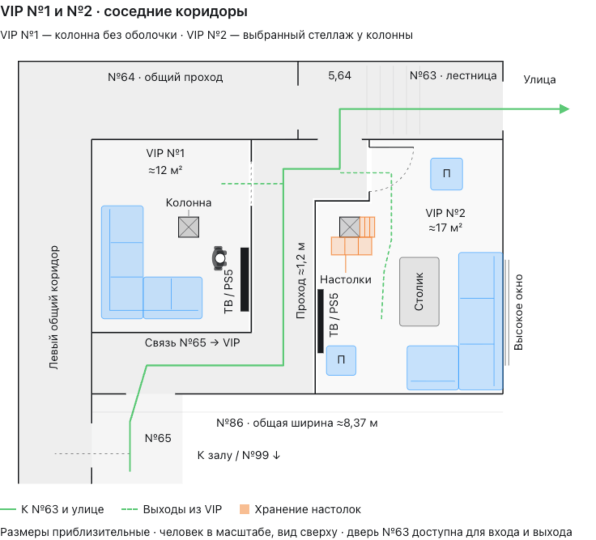

# Планировка VIP-зон

Актуализировано **04.11.2026**. Основа — общий план VIP от **16.10.2026**, включённый в полный план **v6 от 17.10.2026**. Размеры приблизительные; окончательная вместимость не установлена.

## Общий план

[PNG](Материалы/Планы/VIP-1-и-VIP-2/План-VIP-1-и-VIP-2-с-коридорами.png) · [SVG](Материалы/Планы/VIP-1-и-VIP-2/План-VIP-1-и-VIP-2-с-коридорами.svg) · [HTML](Материалы/Планы/VIP-1-и-VIP-2/План-VIP-1-и-VIP-2-с-коридорами.html)

Обе VIP находятся в №86. Каждая имеет вход из общего коридора около 1,20 м; нижняя связь от №65 — около 1,25 м. К северу проход поворачивает к №63 и улице. Наличие и доступность двери №63 подтверждены пользователем 16.10.2026; пригодность пути как эвакуационного ещё проверить.

## VIP №1 — текущая основа

| Элемент | Расстановка |
|---|---|
| Комната | Около 3,20 × 3,93 м, округлённая площадь около 12 м² |
| Диван | Угловой, габарит около 2,30 × 2,05 м; глубина секций около 0,85 м |
| ТВ и PS5 | У правой внутренней стены |
| Колонна | Около 0,41 × 0,41 м, без мебельной оболочки |
| Вход | Справа, проём около 0,90 м |

Это расстановка из общего плана. В [архиве вариантов](Материалы/Архив/VIP-1-варианты/README.md) сохранены «Прямой диван», «Экран сверху» и «Уголок со столом». **Ни один из трёх вариантов не выбран**, поэтому они не заменяют VIP №1 в v6.

## VIP №2 — выбранный «Стеллаж у колонны»

[Отдельный PNG](Материалы/Планы/VIP-2/VIP-2-стеллаж-у-колонны.png) · [SVG](Материалы/Планы/VIP-2/VIP-2-стеллаж-у-колонны.svg) · [HTML](Материалы/Планы/VIP-2/VIP-2-стеллаж-у-колонны.html)

| Элемент | Расстановка |
|---|---|
| Комната | Около 17 м²; основная ширина около 3,77 м, глубина до 5,18 м, сверху уступ под общий коридор |
| Диван | Угловой, около 2,80 × 1,95 м, у правой стены под высоким окном; прохода за спинкой нет |
| Столик | 1,40 × 0,80 м, зазоры до обеих секций дивана около 0,40 м |
| Сиденья | Два пуфа около 0,65 × 0,65 и 0,60 × 0,60 м, дополнительно к дивану |
| ТВ и PS5 | У левой внутренней стены |
| Колонна и полки | Колонна 0,41 × 0,41 м внутри VIP; полки справа и снизу глубиной около 0,30–0,36 м, доступ из комнаты |
| Вход | В верхнем коротком участке перегородки, ближе к №63; проём около 0,90 м, открывание внутрь |

Перегородка коридора сохраняется. Колонна не переносится в перегородку; полки не занимают общий проход. №88 — высоко расположенный щит автоматики, без отдельной напольной зоны в текущем эскизе.

## До оснащения

Проверить обзор ТВ с каждого места, чистые проходы, открывание двери VIP №2, доступ к автоматике, вентиляцию и акустику. Шторы обсуждались как идея; текущие рисунки показывают перегородки и не подтверждают их замену шторами.

Модели PS5, телевизоров, контроллеры, мебель, игры и стоимость оснащения VIP ещё не подобраны. Расходы включены как открытые статьи в [общую смету](Затраты-клуба.md). LANGAME пока рассчитан на 10 игровых ПК и ПК администратора; интеграция ТВ может добавить оплачиваемые устройства.

Связанные документы: [общая планировка](Планировка-клуба.md), [исходники и графика](Материалы/README.md).
