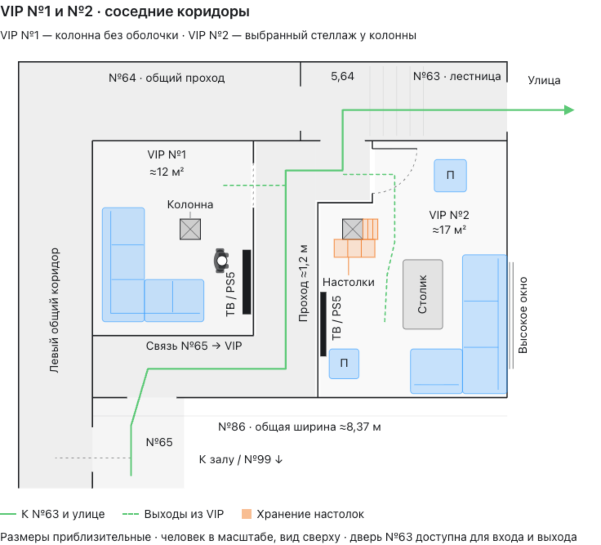

# VIP №1 и №2 — общий план с коридорами

Сохранён 16 октября 2026 года по просьбе пользователя. Это последняя общая визуализация перед подготовкой трёх новых предложений для VIP №1.

## Файлы

- [План для браузера](План-VIP-1-и-VIP-2-с-коридорами.html).
- [Рисунок PNG](План-VIP-1-и-VIP-2-с-коридорами.png).
- [Векторный рисунок SVG](План-VIP-1-и-VIP-2-с-коридорами.svg).
- [Редактируемый исходник](План-VIP-1-и-VIP-2-с-коридорами.source.html).
- [Геометрия и контекст](План-VIP-1-и-VIP-2-с-коридорами.context.json).

## Содержание

- VIP №1: прежний угловой диван и ТВ справа. Колонна около 0,41 × 0,41 м без условной оболочки 0,65 × 0,65 м. Человек сверху для масштаба.
- VIP №2: выбранный в соседнем чате вариант «Стеллаж у колонны» из папки `../VIP-2/`. Угловой диван у высокого окна, два пуфа, столик 1,4 × 0,8 м, дверь ближе к №63.
- Левый общий коридор, верхняя зона №64, нижняя связь от №65, проход между VIP около 1,2 м, лестница №63 и путь на улицу.
- Дверь №63 существует и доступна для входа и выхода — подтверждение пользователя от 16.10.2026.

Размеры и положения приблизительные, до обмера. Новые варианты VIP №1 находятся в `../VIP-1/`; они пока не выбраны и в этот сохранённый общий план не внесены.

