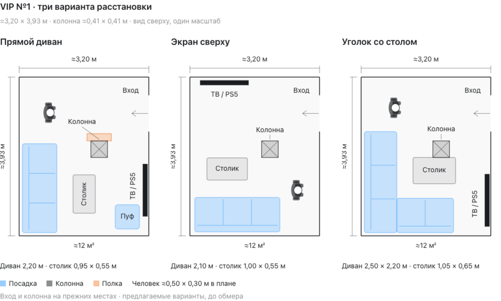

# VIP №1 — три предложения по расстановке

Подготовлены 16 октября 2026 года. Пользователь пока не выбрал вариант. В визуализации показана только VIP №1, без коридоров и VIP №2.

Общие исходные данные: комната около 3,20 × 3,93 м, ориентировочно 12 м²; существующая колонна около 0,41 × 0,41 м на координатах x=1,77, y=1,58 м. Вход справа в прежнем проёме около 0,90 м. Колонна без оболочки во всех трёх вариантах. Размеры и привязки требуют обмера.

## Варианты

1. **Прямой диван.** Диван 2,20 × 0,85 м у левой стены, ТВ справа; основная зона просмотра ниже колонны. Столик 0,95 × 0,55 м, мобильный пуф 0,60 × 0,60 м. С верхней стороны колонны отдельная полка глубиной около 18 см.
2. **Экран сверху.** Диван 2,10 × 0,85 м у нижней стены и ТВ на верхней стене со смещением влево. Колонна справа от основного направления просмотра. Столик 1,00 × 0,55 м, колонна без навесной мебели.
3. **Уголок со столом.** Угловой диван с габаритом 2,50 × 2,20 м вдоль левой и нижней стен; ТВ справа. Отдельный низкий столик 1,05 × 0,65 м примыкает к нижней грани колонны. До дивана слева около 40 см, снизу около 36 см. Столик не является зашивкой колонны.

Человек показан сверху в одном масштабе с мебелью, габарит около 0,50 × 0,30 м в плане. Координаты отсчитываются от верхнего левого угла комнаты.

## Файлы

- [Сравнение для браузера](VIP-1-три-варианта.html).
- [Общее сравнение PNG](VIP-1-три-варианта.png).
- [Редактируемый исходник](VIP-1-три-варианта.source.html).
- [Геометрия и контекст](VIP-1-три-варианта.context.json).
- Векторные планы: [Прямой диван](VIP-1-Прямой-диван.svg), [Экран сверху](VIP-1-Экран-сверху.svg), [Уголок со столом](VIP-1-Уголок-со-столом.svg).

Предыдущий общий план с актуальной VIP №2 и коридорами сохранён отдельно в [VIP-1-и-VIP-2](../VIP-1-и-VIP-2/README.md).

