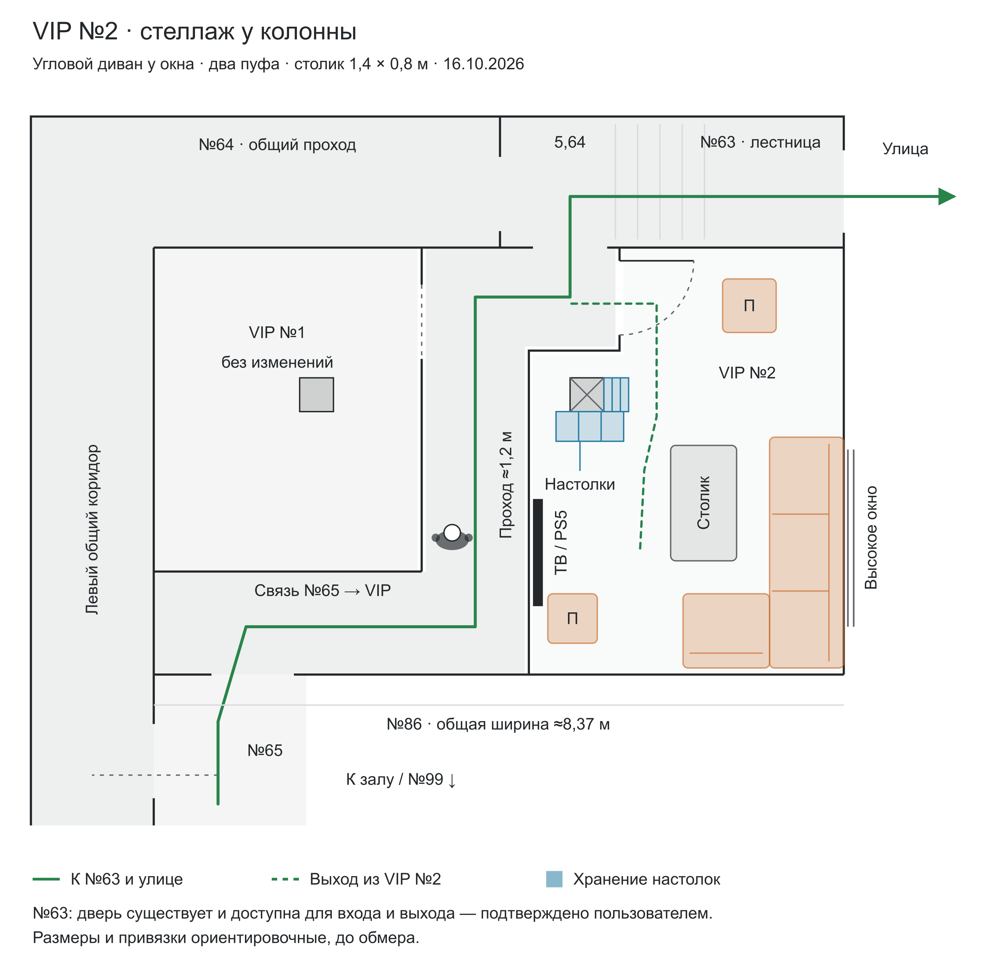

# VIP №2 — стеллаж у колонны

Выбран пользователем и сохранён отдельно 16 октября 2026 года. Расстановка основана на варианте 3 с угловым диваном; оформление колонны — «Стеллаж у колонны». Сохранённая версия содержит только этот вид.

## Файлы

- [Рисунок PNG](VIP-2-стеллаж-у-колонны.png) — 2944 × 2812 пикселей, 300 dpi, светлый фон.
- [Векторный рисунок SVG](VIP-2-стеллаж-у-колонны.svg) — для увеличения и печати.
- [План для браузера](VIP-2-стеллаж-у-колонны.html) — самостоятельный HTML, открывается без сервера; дополнительные подсказки используют внешние библиотеки. PNG и SVG полностью локальны.
- [Редактируемый исходник](VIP-2-стеллаж-у-колонны.source.html) — геометрия, подписи и код рисунка.
- [Структурированный контекст](VIP-2-стеллаж-у-колонны.context.json) — принятые решения, координаты и SHA-256 исходника.

## Зафиксированные решения

- Угловой диван около 2,8 × 1,95 м придвинут к правой стене под высоким окном. Полосы прохода за спинкой нет.
- Верхнее кресло заменено пуфом; нижний пуф сохранён. Итого два пуфа и ориентировочно четыре места на диване.
- Столик 1,4 × 0,8 м расположен внутри угла перед диваном. Зазоры до обеих секций около 40 см. При сдвиге дивана столик передвинут вместе с ним.
- Телевизор и PS5 находятся у левой внутренней стены. Вход в VIP №2 — в верхнем коротком участке перегородки, рядом с поворотом к №63; дверь показана с открыванием внутрь.
- Существующая колонна около 0,41 × 0,41 м сохраняется внутри VIP. У неё показаны полки для настолок глубиной около 30–36 см, открывающиеся внутрь комнаты. Перегородка коридора остаётся в прежнем положении; колонна в неё не включается.
- Общий проход между VIP около 1,2 м, нижняя связь от №65, левый общий коридор и лестничный узел №63 показаны в контексте планировки. Зелёная линия ведёт через №63 на улицу; пунктир показывает выход из VIP №2 в общий проход. Связь с основным залом и №99 обозначена направлением вниз.
- Уточнение пользователя от 16.10.2026: **дверь №63 существует и доступна для выхода и входа в помещение**. Это подтверждение сохранено в подписи рисунка и контексте.
- №88 — высоко расположенный щит автоматики, предположительно связанный с вытяжками; в напольной расстановке пока игнорируется.
- Человек сверху показан для масштаба, ширина плеч около 0,5 м. VIP №1 показана контуром для привязки коридора.

Размеры и положения объектов ориентировочные, до обмера. Полный исторический план клуба — версия 5 в родительской папке. При продолжении работы над VIP №2 использовать материалы этой папки.

## Источники

- Полный план клуба: `../План-клуба-v5.source.html` и `../Исходный-план-помещения.jpg`.
- Выбранный в чате вид: `/Users/zikunov_semen/.codex/visualizations/2026/10/14/01a1382a-a075-7a32-8563-3f0379106140/vip-room-2-column-corridors.html`, оформление колонны `storage`.

