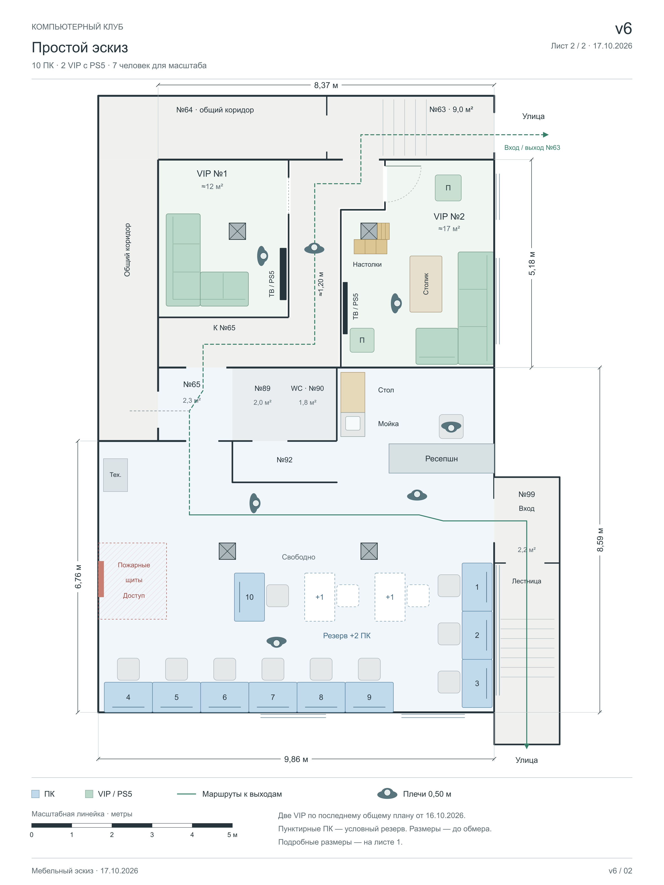

# План клуба — версия 6

Сохранён 17 октября 2026 года. Два рисунка: подробный план с размерами и простой эскиз той же расстановки.

## Открыть

- [Оба листа для браузера](План-клуба-v6.html) — локальный HTML с переключением листов; работает без сети.
- **Лист 1, с размерами:** [PNG](План-клуба-v6-с-размерами.png), [SVG](План-клуба-v6-с-размерами.svg).
- **Лист 2, простой эскиз:** [PNG](План-клуба-v6-эскиз.png), [SVG](План-клуба-v6-эскиз.svg).

Подробный PNG — 6300 × 4455 пикселей, эскиз — 3150 × 4200; оба 300 dpi. SVG можно увеличивать без потери чёткости. Для оценки масштаба на обоих планах есть метровая линейка и семь человек сверху с шириной плеч 0,50 м. Фигура в легенде эскиза служит дополнительным образцом.

## Изменения относительно v5

- VIP №2 перенесена из выбранного и сохранённого варианта «Стеллаж у колонны»: угловой диван 2,80 × 1,95 м у высокого окна, столик 1,40 × 0,80 м, два пуфа и полки у существующей колонны. Дверь находится в верхнем коротком участке перегородки, ближе к №63.
- VIP №1 перенесена из последнего общего плана от 16.10.2026: прежний угловой диван, ТВ справа, колонна без оболочки. Три последующих предложения в папке `../VIP-1/` пока не выбраны и в v6 не подставлены.
- Витрина между колоннами в помещении с ПК полностью убрана. Это место свободно.
- На подробном листе добавлены габариты блоков, проходы и проёмы, привязки колонн, размеры мебели и зазоры. VIP-комнаты показаны отдельным увеличенным фрагментом. Мелкие размеры собраны в ведомость на том же листе.
- Сохранены 10 ПК, два условных места резерва, ресепшн, открытые стол и мойка, свободный доступ к пожарным щитам и общие коридоры.
- Учтено подтверждение пользователя: дверь №63 существует и доступна для входа и выхода. №88 не выделяется как отдельная напольная зона: это высоко расположенный щит автоматики.

## Как читать размеры

Все размеры — в метрах. Чёрные размерные подписи воспроизводят читаемые значения исходного плана: 8,37; 5,18; 9,86; 6,76; 8,59; сечение колонн 0,41 × 0,41 м. Высота h = 4,37 м также взята с исходника. Синие значения со знаком **≈** вычислены из сохранённой геометрии эскиза, включая расстановку мебели; они требуют обмера. Толщина линий стен условная.

Привязки колонн относятся к их левой и верхней грани. Начало координат — верхний левый внутренний угол №86; X направлен вправо, Y вниз. Нижний блок использует ту же систему координат.

«5,64» — ориентир на исходном плане, а не ширина показанного проёма. Размер 2,60 × 1,83 относится к общему условному блоку №89/90, а не к каждой комнате отдельно. Контур №99 схематичный; площадь 2,2 м² оставлена по исходнику и не выведена из этого прямоугольника. Площади VIP около 12 и 17 м² сохраняют прежнее округление. Условный резерв +2 ПК требует отдельной проверки проходов с занятыми креслами.

Это мебельный эскиз до обмера; нормативная проверка маршрутов в эту версию не входит.

## Источники и редактирование

- Полный исходный контур: `../План-клуба-v5.source.html`.
- Сверка читаемых размеров: `../Исходный-план-помещения.jpg`.
- Актуальная геометрия VIP: `../VIP-1-и-VIP-2/План-VIP-1-и-VIP-2-с-коридорами.context.json`.
- [Генератор рисунков](generate_v6.py) — геометрия, подписи, размеры, HTML и контекст.
- [Растеризация](render_v6.cjs) — PNG из SVG с помощью Node.js и Sharp.
- [Структурированный контекст v6](План-клуба-v6.context.json) — решения, источники, нанесённые размеры и контрольные суммы SVG.

Для повторной сборки запустить `python3 generate_v6.py`, затем `node render_v6.cjs` в среде с пакетом `sharp`. В сохранённом HTML оба SVG встроены, PNG-ссылки ведут к файлам рядом.

